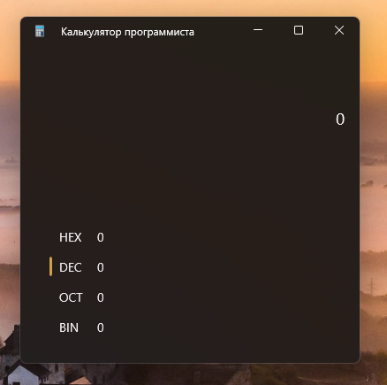
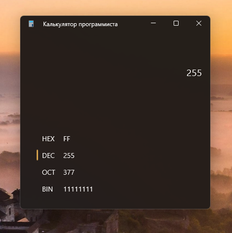
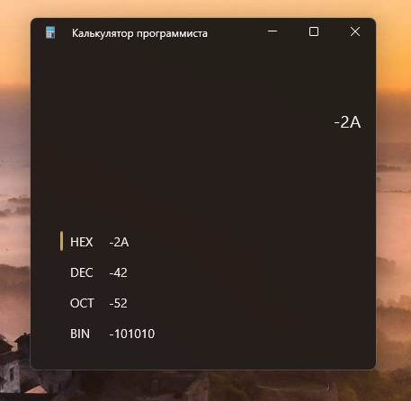

# Calculator

Небольшое настольное приложение для Windows, предназначенное для перевода целых чисел между двоичной, восьмеричной, десятичной и шестнадцатеричной системами счисления. Проект создан на **C#**, **.NET 10** и **WinUI 3** и работает в режиме **Unpackaged** — без установки и запуска через MSIX-пакет.

Интерфейс выполнен в компактном тёмном стиле: крупное отображение текущего числа, список представлений BIN / OCT / DEC / HEX и цветовой индикатор выбранной системы счисления. Окно использует Mica backdrop.

<!--
Скриншот 1 — главное окно.
Сделай снимок всего окна приложения в квадратном размере 520 × 520.
Оставь значение 0 и выбранную систему DEC (янтарный индикатор слева от DEC).
Убедись, что интерфейс чистый: нет курсора поверх строк, всплывающих подсказок или сообщений об ошибке.
Сохрани файл как docs/screenshots/calculator-main.png.
-->

## Возможности

- **Перевод между системами счисления** — двоичная (BIN, основание 2), восьмеричная (OCT, основание 8), десятичная (DEC, основание 10) и шестнадцатеричная (HEX, основание 16).
- **Автоматическая конвертация** — все четыре представления числа обновляются при вводе и изменении исходной системы счисления.
- **Выбор исходной системы** — нажми на строку HEX, DEC, OCT или BIN; активная система отмечается янтарным индикатором.
- **Большие целые числа** — для хранения и вычислений используется `System.Numerics.BigInteger`, поэтому длина числа не ограничена фиксированным размером машинного целого или буфера форматирования.
- **Отрицательные значения** — знак числа можно переключать клавишей минуса.
- **Проверка допустимых цифр** — приложение проверяет каждую вводимую цифру с учётом выбранного основания и сообщает об ошибочном вводе.
- **Ввод с клавиатуры** — поддерживаются цифровые клавиши, цифровой блок клавиатуры и символы A–F.
- **Минималистичный интерфейс** — крупная строка текущего значения и компактный список результатов без дополнительных арифметических и побитовых операций.

### Управление с клавиатуры

| Клавиша | Действие |
| -------- | -------- |
| `0–9` | Ввод цифры, если она допустима в выбранной системе |
| `A–F` | Ввод шестнадцатеричной цифры, если она допустима в выбранной системе |
| `NumPad 0–9` | Ввод цифр с цифрового блока клавиатуры |
| `-` | Изменение знака числа |
| `Backspace` | Удаление последнего символа |
| `Esc` | Сброс значения к нулю |

Калькулятор выполняет только преобразование представления целого числа. Арифметические действия (сложение, вычитание, умножение и деление) и побитовые операции в приложение не входят.

## Примеры работы

<!--
Скриншот 2 — конвертация десятичного числа.
Выбери DEC и введи 255. На снимке должны одновременно читаться:
HEX = FF, DEC = 255, OCT = 377, BIN = 11111111.
Покажи всё окно целиком, чтобы была видна янтарная отметка выбранной строки DEC.
Сохрани файл как docs/screenshots/calculator-conversion.png.
-->

<!--
Скриншот 3 — шестнадцатеричное и отрицательное число.
Выбери HEX и введи -2A. На снимке должны быть видны:
HEX = -2A, DEC = -42, OCT = -52, BIN = -101010.
Убедись, что активна строка HEX и янтарный индикатор находится напротив неё.
Сохрани файл как docs/screenshots/calculator-hex-negative.png.
-->

## Технологический стек

| Технология | Использование |
| ---------- | ------------- |
| C# | Язык программирования |
| .NET 10 | Целевая платформа приложения |
| WinUI 3 | Нативный пользовательский интерфейс Windows |
| Windows App SDK | API и компоненты WinUI 3 |
| XAML | Разметка интерфейса |
| MVVM | Разделение представления и логики приложения |
| System.Numerics.BigInteger | Представление целых чисел произвольной точности |
| INotifyPropertyChanged | Уведомление интерфейса об изменениях ViewModel |
| ICommand | Команды ViewModel |

Проект настроен как **Unpackaged WinUI 3 application**:

- Target Framework: `net10.0-windows10.0.26100.0`
- Минимальная версия Windows: `10.0.17763.0`
- Поддерживаемые архитектуры: `x86`, `x64`, `ARM64`
- MSIX-пакетирование отключено через свойство `WindowsPackageType` со значением `None`.

## Архитектура

В проекте используется MVVM без стороннего MVVM-фреймворка. Уведомления об изменениях свойств и команды реализованы непосредственно в проекте.

    Calculator/
    ├── Assets/
    ├── Infrastructure/
    │   ├── ObservableObject.cs
    │   └── RelayCommand.cs
    ├── Models/
    │   └── NumberBaseOption.cs
    ├── Properties/
    │   └── launchSettings.json
    ├── Services/
    │   └── NumberBaseConverter.cs
    ├── ViewModels/
    │   └── CalculatorViewModel.cs
    ├── App.xaml
    ├── App.xaml.cs
    ├── MainWindow.xaml
    ├── MainWindow.xaml.cs
    ├── MainPage.xaml
    ├── MainPage.xaml.cs
    ├── Calculator.csproj
    ├── Package.appxmanifest
    ├── app.manifest
    └── README.md

### Ответственность компонентов

- **MainPage.xaml** — визуальное представление конвертера, отображение текущего числа и результатов в четырёх системах счисления.
- **MainPage.xaml.cs** — обработка клавиатуры, выбор исходной системы и обновление индикатора активной строки. Логика преобразования чисел в code-behind не размещается.
- **CalculatorViewModel** — состояние текущего числа, выбранное основание, значения для HEX / DEC / OCT / BIN, состояние ошибки и команды управления.
- **NumberBaseConverter** — разбор строки в `BigInteger` с проверкой цифр и форматирование числа в заданной системе счисления.
- **NumberBaseOption** — модель пункта с названием системы счисления и её основанием.
- **ObservableObject** — базовая реализация `INotifyPropertyChanged` и вспомогательного метода `SetProperty`.
- **RelayCommand** — простая реализация `ICommand` с поддержкой проверки возможности выполнения команды.
- **MainWindow.xaml** — заголовок окна и Mica backdrop.
- **MainWindow.xaml.cs** — создание главного окна, настройка заголовка и начального размера окна.

### Как выполняется конвертация

1. Вводимая строка разбирается с учётом текущего основания: 2, 8, 10 или 16.
2. Полученное значение хранится в `BigInteger`, независимо от выбранного представления.
3. ViewModel форматирует это значение для BIN, OCT, DEC и HEX.
4. При выборе другой исходной системы текущее число сначала преобразуется в числовое значение, а затем отображается в новом основании. Само значение при этом не меняется.

Парсер и форматтер поддерживают основания от 2 до 16, а пользовательский интерфейс предоставляет четыре системы: BIN, OCT, DEC и HEX.

## Требования

Для сборки проекта необходимы:

- Windows 10 или Windows 11.
- **.NET 10 SDK**.
- Windows SDK и компоненты сборки, необходимые для WinUI 3.
- Доступ к NuGet для восстановления пакетов, перечисленных в `Calculator.csproj`.

В проекте используются следующие NuGet-пакеты (версии и условия подключения задаются в `Calculator.csproj`):

- Microsoft.Windows.SDK.BuildTools
- Microsoft.WindowsAppSDK
- Microsoft.Windows.SDK.BuildTools.WinApp

## Сборка и запуск

Клонируй репозиторий:

    git clone https://github.com/Zaka22k/calculator.git
    cd calculator

Восстанови зависимости и собери приложение:

    dotnet restore .\Calculator.csproj
    dotnet build .\Calculator.csproj -c Debug

Запусти приложение:

    dotnet run --project .\Calculator.csproj

Также проект можно открыть в Visual Studio с установленной поддержкой WinUI 3 и запускать из IDE.
